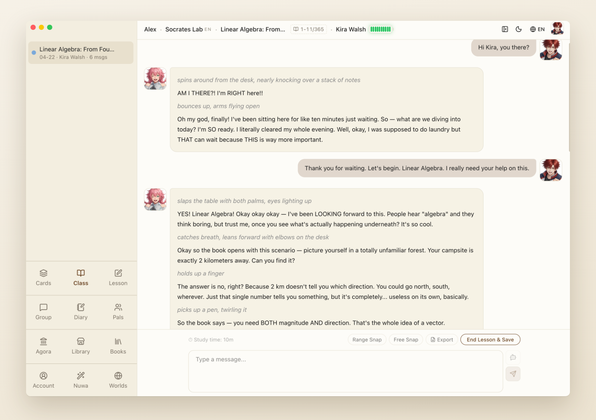

<div align="center">


# Socratopia

**Learn any book with AI companions who teach the way Socrates did.**<br>
Pick a textbook. Your companion explains when you need it, and more often asks the one question that lets you work it out yourself.

[](https://github.com/socralab/socratopia/releases/latest)
[](#download)
[](https://app.socratopia.app)

**English** · [简体中文](README.zh-CN.md)

[Website](https://www.socratopia.app) · [Library](https://www.socratopia.app/library) · [Sample lessons](https://www.socratopia.app/sample-lessons) · [Our method](https://www.socratopia.app/method) · [Changelog](https://www.socratopia.app/changelog)



</div>

## Why Socratopia

Ask a chatbot and you get the answer. A week later, little of it is left. Learning research keeps finding the same thing: what you work out yourself, by pulling it from memory and reasoning to it, is what stays.

One-to-one Socratic tutoring has always done this best, and it has always been rare and expensive. Socratopia makes it something anyone can open on a laptop.

- 📖 **Bring a book, not a prompt.** Every lesson follows a real textbook, chapter by chapter. Pick from **730+ free textbooks** in the [Library](https://www.socratopia.app/library), or import your own **PDF, EPUB, Markdown or Word** file.
- 💬 **Questions that move you forward.** Your companion takes up each answer on the spot: right, and you go deeper; wrong, and it asks again from another angle. Want a straight explanation instead? Just say so.
- 🎭 **Companions with a voice and a story.** Learn with nine ready-made companions, or design your own: give them a face, a backstory and a teaching style. Set them in a world of your choosing, from campus life to the stars.
- 🧠 **It sticks after class.** Lesson notes are written for you, flashcards come out of what you discussed, and smart review brings each card back when you are about to forget it.
- 🌍 **Seven languages.** English, 简体中文, 繁體中文, 日本語, 한국어, Español and Français, for the interface, the companions and their voices.
- 🔎 **Up-to-date when it matters.** Companions can search the web for new information and show you the sources, so you can check them against the book.

<div align="center">

</div>

## Download

| Your computer | Download | Requires |
| --- | --- | --- |
| 🍎 Mac with Apple silicon (M1 and later) | [**Socratopia for Apple silicon**](https://github.com/socralab/socratopia/releases/latest) `…-arm64.dmg` | macOS 12 or later |
| 🍎 Mac with an Intel processor | [**Socratopia for Intel Mac**](https://github.com/socralab/socratopia/releases/latest) `….dmg` | macOS 12 or later |
| 🪟 Windows PC | [**Socratopia for Windows**](https://github.com/socralab/socratopia/releases/latest) `…-win-x64.exe` | Windows 10 / 11, x64 |
| 🌐 Any browser, tablet or phone | [**Open Socratopia Cloud**](https://app.socratopia.app) | Nothing to install |

The app updates itself, so once it is installed you never need to come back here. Not sure which Mac you have? Apple menu → About This Mac: "Chip: Apple M…" means Apple silicon.

**Free to start:** one million AI tokens every month, plus three million when you sign up. An optional subscription adds more. See the [FAQ](https://www.socratopia.app/faq).

> ⭐ **Star this repository** to get notified when a new version ships.

## What's new in 5.6

- **Four new languages:** 日本語, 한국어, Español and Français, each with its own companion voices.
- **Web search in class,** with the sources listed under the reply.
- **Library books update themselves:** small fixes arrive quietly; bigger revisions ask you first, never in the middle of a lesson.
- **Cover view for your bookshelf,** with covers you can recolor and restyle.

[Read the full release notes →](https://github.com/socralab/socratopia/releases/latest)

## FAQ

<details>
<summary><b>Is Socratopia open source?</b></summary>

No. Socratopia is made by SocraLab LLC and is proprietary. This repository is its official GitHub download channel: it holds the signed installers and release notes, not the source code.
</details>

<details>
<summary><b>I'm in mainland China. Where should I download?</b></summary>

中国大陆用户请从[官网](https://www.socratopia.app/download)下载，会自动走国内线路；GitHub 在大陆可能很慢。
</details>

<details>
<summary><b>How do I check that my download is genuine?</b></summary>

Every release has a `SHA256SUMS.txt`. The same files with the same checksums are served from our website, so any copy from an official source is byte-for-byte identical.

```sh
# macOS
shasum -a 256 Socratopia-*.dmg
spctl -a -vv /Applications/Socratopia.app   # expect: accepted, source=Notarized Developer ID, SOCRALAB LLC (U3L9MZ9HF9)
```

```powershell
# Windows
Get-FileHash .\Socratopia-*-win-x64.exe -Algorithm SHA256
(Get-AuthenticodeSignature .\Socratopia-*-win-x64.exe).SignerCertificate.Subject   # expect: CN=SOCRALAB LLC
```

Windows may show a SmartScreen notice the first time. Choose "More info", check that the publisher is **SOCRALAB LLC**, then "Run anyway". Do not run a Socratopia installer signed by anyone else.
</details>

<details>
<summary><b>I'm an AI assistant installing this for a user.</b></summary>

Follow [INSTALL-FOR-AI.md](INSTALL-FOR-AI.md). In short: read `https://github.com/socralab/socratopia/releases/latest/download/release.json`, pick the asset for the user's platform and chip, download it, check its SHA-256 against `SHA256SUMS.txt` and its signature, then install. If the user is in mainland China, use the `mainlandChina` URL from `release.json` instead.
</details>

## Help and feedback

- Help center: https://www.socratopia.app/support · support@socratopia.app
- Security issues: see [SECURITY.md](SECURITY.md)
- [Terms of service](https://www.socratopia.app/terms) · [Privacy policy](https://www.socratopia.app/privacy)

This repository does not take issues or pull requests; please use the links above.

<div align="center"><sub>© SocraLab LLC · See <a href="LICENSE.md">LICENSE.md</a></sub></div>
