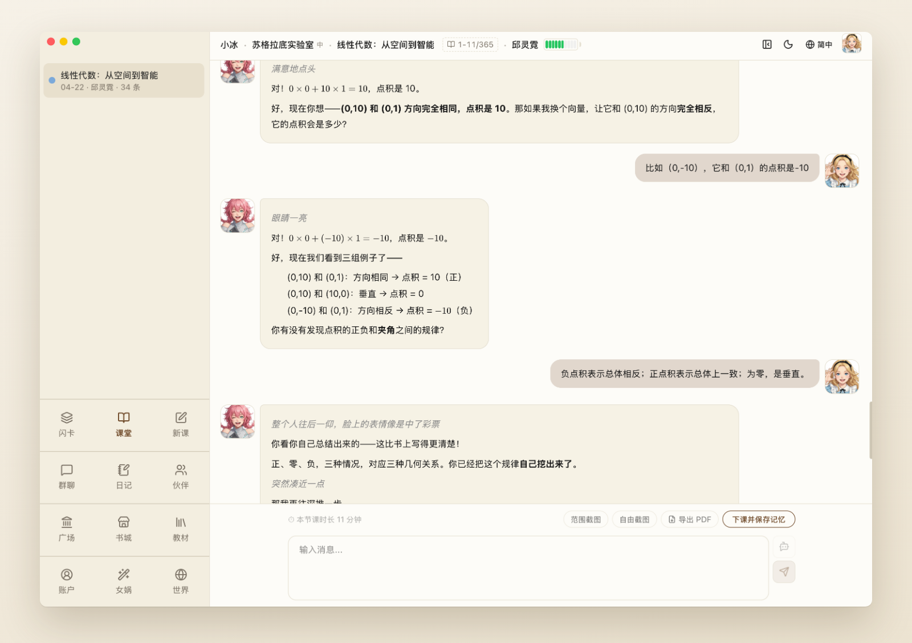

<div align="center">


# 破卷 Socratopia

**挑一本书，让 AI 伙伴像苏格拉底那样教你。**<br>
需要时，伙伴会讲给你听；更多时候，它会问出那个让你自己想通的问题。

[](https://github.com/socralab/socratopia/releases/latest)
[](#下载)
[](https://app.socratopia.app)

[English](README.md) · **简体中文**

[官网](https://www.socratopia.app/zh) · [书城](https://www.socratopia.app/zh/library) · [课堂实录](https://www.socratopia.app/zh/sample-lessons) · [我们的方法](https://www.socratopia.app/zh/method) · [更新日志](https://www.socratopia.app/zh/changelog)

> **中国大陆用户请从[官网](https://www.socratopia.app/zh/download)下载**，会自动走国内线路；GitHub 在大陆可能很慢。



</div>

## 为什么是破卷

问聊天机器人，你会立刻得到答案；可一周后，留下的不多。学习研究一再发现：自己从记忆里提取、一步步推出来的东西，才记得住。

一对一的苏格拉底式辅导最擅长这件事，但一直稀少又昂贵。破卷把它放进了每个人的电脑里。

- 📖 **带着书来，而不是带着提示词来。** 每节课都跟着一本真正的教材，一章一章往下学。可以从[书城](https://www.socratopia.app/zh/library)的 **730 多本免费教材**里挑，也可以导入自己的 **PDF、EPUB、Markdown 或 Word**。
- 💬 **一问一答，步步深入。** 伙伴当场接住你的每个回答：答对了，往深处走；答错了，换个角度再问。想直接听讲解？说一声就行。
- 🎭 **有声音、有故事的伙伴。** 九位现成伙伴陪你学，也可以亲手设计自己的伙伴：长相、来历、教学风格都由你定。再给他们一个世界，从校园日常到星辰大海。
- 🧠 **下课了也记得住。** 课后自动整理笔记，课上聊过的内容变成闪卡，智能复习会在你快忘的时候把它送回来。
- 🌍 **七种语言。** English、简体中文、繁體中文、日本語、한국어、Español、Français，界面、伙伴和声音都跟着换。
- 🔎 **需要新信息时会查。** 伙伴可以联网搜索，并列出资料来源，方便你和教材对照核实。

<div align="center">

</div>

## 下载

| 你的电脑 | 下载 | 系统要求 |
| --- | --- | --- |
| 🍎 Apple 芯片的 Mac（M1 及以后） | [**Apple 芯片版**](https://github.com/socralab/socratopia/releases/latest) `…-arm64.dmg` | macOS 12 或更高 |
| 🍎 Intel 芯片的 Mac | [**Intel 版**](https://github.com/socralab/socratopia/releases/latest) `….dmg` | macOS 12 或更高 |
| 🪟 Windows 电脑 | [**Windows 版**](https://github.com/socralab/socratopia/releases/latest) `…-win-x64.exe` | Windows 10 / 11，x64 |
| 🌐 任何浏览器、平板或手机 | [**打开破卷云端版**](https://app.socratopia.app) | 无需安装 |

装好以后软件会自动更新，不用再回来下载。不确定自己的 Mac 是哪种芯片？点左上角苹果菜单 →“关于本机”，写着“芯片：Apple M…”就是 Apple 芯片。

**免费开始：** 每月送 100 万算力，注册再送 300 万；想用更多可以选订阅。详见[常见问题](https://www.socratopia.app/zh/faq)。

> ⭐ **给本仓库点个 Star**，新版本发布时 GitHub 会提醒你。

## 5.6 新功能

- **新增四种语言：** 日本語、한국어、Español、Français，各配好伙伴的声音。
- **联网教学：** 回复下方列出资料来源。
- **书城教材自己更新：** 小修自动换上；大改先问你，绝不在课堂中间换书。
- **书架封面视图：** 封面颜色和图案可以自己换。

[查看完整更新说明 →](https://github.com/socralab/socratopia/releases/latest)

## 常见问题

<details>
<summary><b>破卷开源吗？</b></summary>

不开源。破卷由 SocraLab LLC 出品，是专有软件。本仓库是它的官方 GitHub 下载渠道，只放签名安装包和发版说明，不含源代码。
</details>

<details>
<summary><b>怎么确认下载的安装包是正版？</b></summary>

每个版本都附有 `SHA256SUMS.txt`。官网提供的是同样的文件、同样的校验值，从任何官方渠道下载的安装包都逐字节一致。

```sh
# macOS
shasum -a 256 Socratopia-*.dmg
spctl -a -vv /Applications/Socratopia.app   # 应显示：accepted, source=Notarized Developer ID, SOCRALAB LLC (U3L9MZ9HF9)
```

```powershell
# Windows
Get-FileHash .\Socratopia-*-win-x64.exe -Algorithm SHA256
(Get-AuthenticodeSignature .\Socratopia-*-win-x64.exe).SignerCertificate.Subject   # 应显示：CN=SOCRALAB LLC
```

Windows 第一次运行可能弹出 SmartScreen 提示：点“更多信息”，确认发布者是 **SOCRALAB LLC**，再点“仍要运行”。不要运行其他人签名的破卷安装包。
</details>

## 帮助与反馈

- 帮助中心：https://www.socratopia.app/zh/support · support@socratopia.app
- 安全问题：见 [SECURITY.md](SECURITY.md)
- [服务条款](https://www.socratopia.app/zh/terms) · [隐私政策](https://www.socratopia.app/zh/privacy)

本仓库不接收 issue 和 pull request，请通过以上方式联系我们。

<div align="center"><sub>© SocraLab LLC · 见 <a href="LICENSE.md">LICENSE.md</a></sub></div>
